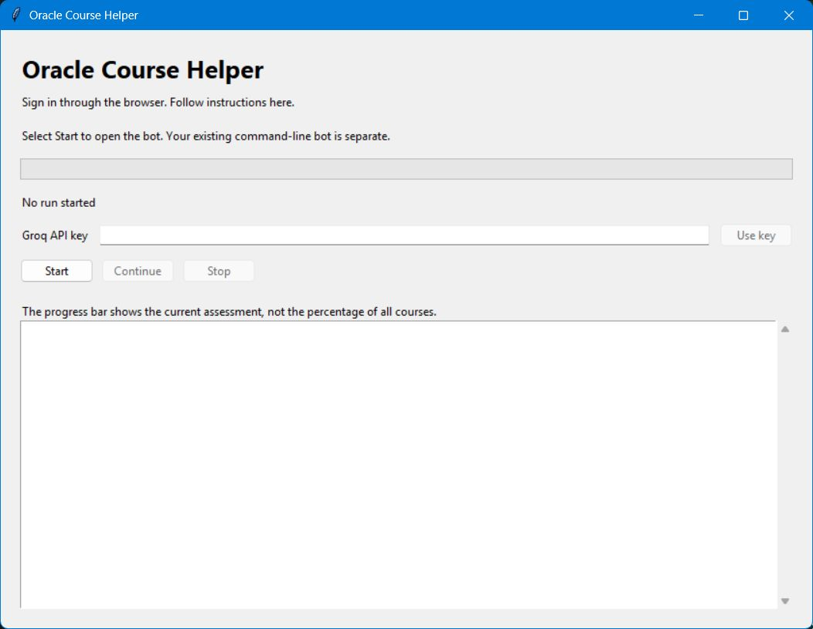

# Windows desktop guide

## Before you start

You need Windows, internet access, your Oracle Academy account with enrolled courses, and a Groq API key. The desktop preview includes Python, Chromium and the application libraries. You do not need Python, Node.js, npm, pip, or Chrome installed separately.

The app is a preview. Its offline checks passed, but its full Oracle workflow has not yet been validated. Obtain **OracleBot-Windows-preview.zip** from the maintainer. GitHub's Download ZIP button downloads the source instead.

## First run

1. Right-click the ZIP and select **Extract All**.
2. Open the extracted **OracleBot** folder.
3. Double-click **OracleBot.exe**. Keep **_internal** beside the executable.
4. Select **Start**, paste your Groq key, then select **Use key**.
5. Sign in to Oracle Academy in Chromium and open **Classes**.
6. Select **Continue** in the app.

The app uses a separate browser profile from the source version. Oracle's saved course progress still belongs to your account, so completed sections are skipped.

## What the window shows

This is a screenshot of the actual application, not a mockup.

| Control or area | Purpose |
| --- | --- |
| Status message | Explains what is happening or what you need to do next. |
| Progress bar | Shows progress through the current assessment, not all courses. |
| Groq key field | Accepts a key; the text is masked. |
| Use key | Supplies a replacement key. An API pause resumes after verification. |
| Start | Opens the worker and browser. |
| Continue | Continues after login or a pause that needs browser attention. |
| Stop | Stops this app's run. Saved Oracle progress remains. |
| Log area | Shows lesson progress, question numbers, warnings, and errors. |
| GitHub button | Appears when the run completes. |

## If Groq runs out of quota

Read the limit message. Paste a key with available quota and select **Use key**. The app verifies it and resumes an API-related pause without another Continue click. Invalid keys leave it paused. Keys in one Groq organization share quota.

Changing the key keeps the browser open. If Oracle expires the login or you restart the app, sign in again, open Classes, and select Continue.

Keys are held in memory for the run and are not included in the ZIP. Closing the app means you must supply a key again.

## Completion and files

At completion, the status says **Finished. Congratulations!** and offers the GitHub repository link. Check your final scores and course status in Oracle.

The app stores its browser profile, feedback, logs and diagnostics under **%LOCALAPPDATA%/OracleBot**. The installed folder contains the program and its bundled runtime.

The Windows executable cannot run on macOS or Linux. Use the [source guide](source-setup.md) or a separately built and tested app for those systems.
